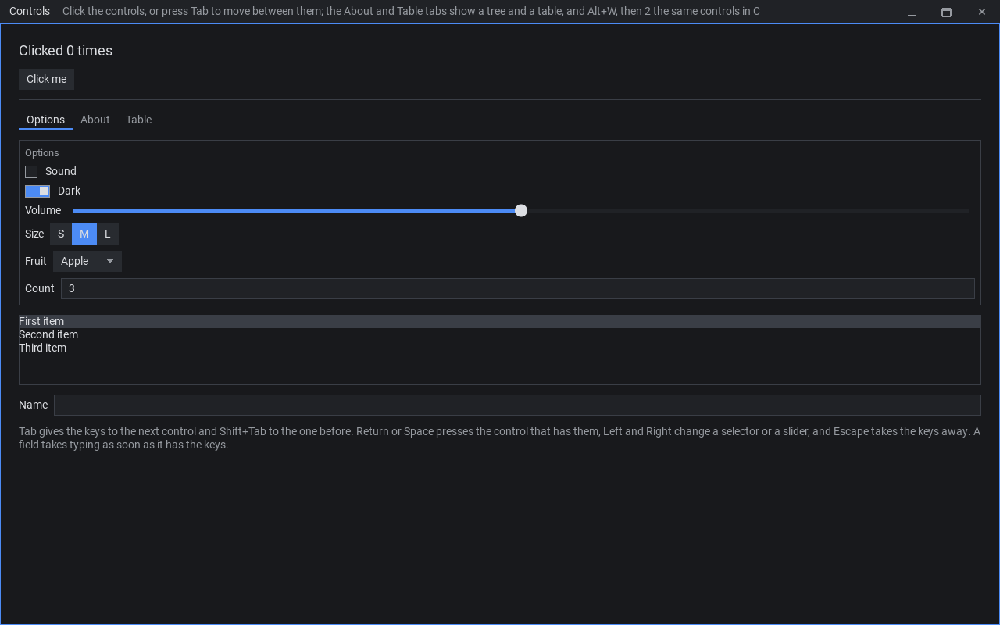
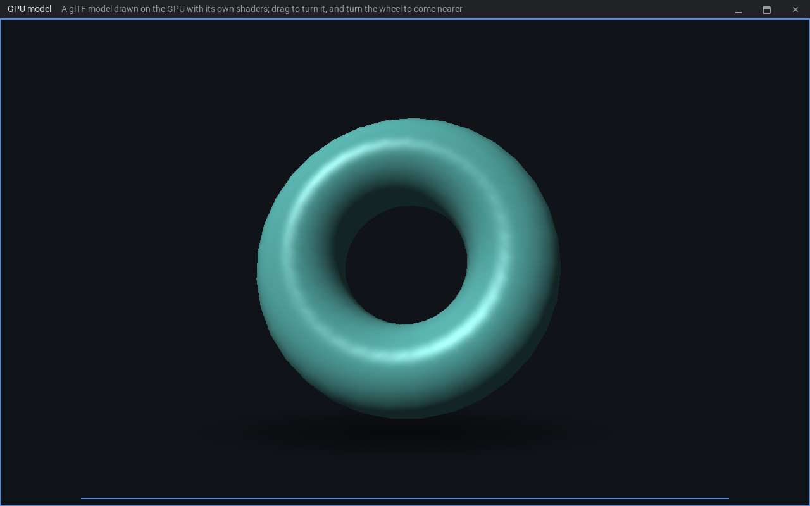

# OpenECS

OpenECS (Editor Composition System, I started it as an Entity Component System engine and somehow got here) is the empty shell of an editor style application, written in C. It provides panels that can be split, grouped into tabs, docked, maximized and moved into their own windows, and workspaces that hold them. It also provides plugins in C and Lua, keybindings, settings, saving and restoring sessions, and operating-system features such as the clipboard, drag and drop and dialogs. It builds and runs on Linux & Windows, I don't have a Mac, so that will not be close for sure.

OpenECS does nothing specific to any domain. Plugins decide what each panel shows and does. A preset names plugins to be used and arrangement of a tool. So the same executable becomes a text editor, a paint program, a log viewer etc.

Anyone who needs a frontend for their backend (like a game engine and/or its editor) or wants to build tools (like a media player, 3D modeller or something) can give this program a chance.

The [standard plugins](https://github.com/omerfuyar/OpenECS-std) give plugins for UI, networking, maths, etc. So a panel starts from more than just a frame buffer.

## Template and examples for OpenECS

Apparently, there will be no presets to start with in this repo. You can use [OpenECS-template](https://github.com/omerfuyar/OpenECS-template) to build your own. See the repo for more detail.

See [examples](https://github.com/omerfuyar/OpenECS-examples) for more examples from simple to more complex preset structures.

## Documents

- [OVERVIEW.md](OVERVIEW.md): what OpenECS is, its scope, and its product decisions.
- [DESIGN.md](DESIGN.md): how OpenECS is built technically.
- [TODO.md](TODO.md): open questions and pending work.
- [AGENTS.md](AGENTS.md): instructions for AI agents working in this repository.

## Usage

Download the archive for your system from [Releases](https://github.com/omerfuyar/OpenECS/releases), unpack it and run `OpenECS` in it. The Linux build needs glibc 2.38 or later, such as Ubuntu 24.04 or Fedora 39. The Windows build needs Windows 10 or later, and opens no console window: its log is `%APPDATA%\openecs\openecs.log`, and started from a terminal, it writes there too. Its `lib/` folder holds the import libraries that a C plugin links on Windows.

### Command line

``` text
Usage: OpenECS [OPTION...] [FILE...]

Starts the launcher, which lists the presets of the presets folders and the saved sessions,
or the tool of a preset or a session. The preset's open function opens each FILE.

Options:
  -p, --preset NAME|FILE  Start from a preset: a name from the presets folders, or a file
  -s, --session FILE      Open a saved session
  -f, --fresh             Start from the preset, not from the tool's last session
  -l, --log-input         Log each key and text event as the system gives it !!! todo remove this !!!
  -t, --test FILE         Run a test; Debug builds only
  -d, --definitions DIR   Write the definition files of every plugin found into DIR, and exit
  -v, --version           Print the version and exit
  -h, --help              Print this help and exit
```

### Examples

!!! todo change example format, make it core examples start with 'c' like c1_hello, std examples 's' like s1_media.
The `examples/` folder shows how to write plugins, from simple to more advanced. `1_hello` to `12_sketch` the plugin interface, then the standard plugins. Its [README](https://github.com/omerfuyar/OpenECS-examples) says how to read and run them:

``` shell
./OpenECS --fresh --preset examples/1_hello/preset.lua
```

| `3_ui`: controls of the ui plugin                                                                                                                   | `22_gpu_model`: a glTF model with its own shaders                                       |
| --------------------------------------------------------------------------------------------------------------------------------------------------- | --------------------------------------------------------------------------------------- |
|  |  |

### Writing plugins

The archive holds `include/`, the plugin interface: `OpenECS.h` for plugins in C, and `ecs.lua`, which tells editors such as VS Code what the `ecs` module of Lua plugins holds. Add that folder to `workspace.library` in your plugin's `.luarc.json`. `ecs.lua` also describes manifests, presets and settings files: write `---@type ecs.Manifest` or `---@type ecs.Preset` above the file's `return` to get completion and checks, as the examples do.

Plugins offer functions to each other. In Lua, `local draw = require("draw")` gives the functions of the plugin `draw`, if your manifest depends on it. The archive's `include/` also holds the definition files of the standard plugins, so with that folder in `workspace.library` your editor completes and checks their functions with no more setup; a C plugin includes the header of the same name, such as `draw.h`. For the functions of other plugins, `--definitions` writes the same files for every plugin it finds, or for a preset's plugins with `--preset`; add their folder to `workspace.library` too:

``` shell
./OpenECS --definitions definitions/
```

## Development

### Repositories

OpenECS holds the core. Two more repositories are its submodules, so a clone with its submodules builds and ships all three:

- [OpenECS-std](https://github.com/omerfuyar/OpenECS-std), in `std/`: the standard plugins, the settings window and the launcher.
- [OpenECS-examples](https://github.com/omerfuyar/OpenECS-examples), in `examples/`: the examples.

[OpenECS-template](https://github.com/omerfuyar/OpenECS-template) is the starting point for a new tool: a preset with its plugins. It is not a submodule.

### To clone the repository

``` shell
git clone --recurse-submodules https://github.com/omerfuyar/OpenECS
```

or

``` shell
git clone https://github.com/omerfuyar/OpenECS
git submodule update --init --recursive
```

### Dependent Packages

#### Linux

##### apt

Ubuntu 18.04, all available features enabled:

``` shell
sudo apt-get update
sudo apt-get install build-essential git make pkg-config cmake ninja-build gnome-desktop-testing libasound2-dev libpulse-dev libaudio-dev libfribidi-dev libjack-dev libsndio-dev libx11-dev libxext-dev libxrandr-dev libxcursor-dev libxfixes-dev libxi-dev libxss-dev libxtst-dev libxkbcommon-dev libdrm-dev libgbm-dev libgl1-mesa-dev libgles2-mesa-dev libegl1-mesa-dev libdbus-1-dev libibus-1.0-dev libudev-dev libthai-dev libusb-1.0-0-dev
```

Ubuntu 22.04+ can also add libpipewire-0.3-dev libwayland-dev libdecor-0-dev liburing-dev to that command line.

##### dnf

Fedora 35, all available features enabled:

``` shell
sudo dnf install gcc git-core make cmake alsa-lib-devel fribidi-devel pulseaudio-libs-devel pipewire-devel libX11-devel libXext-devel libXrandr-devel libXcursor-devel libXfixes-devel libXi-devel libXScrnSaver-devel libXtst-devel dbus-devel ibus-devel systemd-devel mesa-libGL-devel libxkbcommon-devel mesa-libGLES-devel mesa-libEGL-devel vulkan-devel wayland-devel wayland-protocols-devel libdrm-devel mesa-libgbm-devel libusb1-devel libdecor-devel pipewire-jack-audio-connection-kit-devel libthai-devel
```

Fedora 39+ can also add liburing-devel to that command line.

Fedora 40+ needs zlib-ng-compat-static to be added to that command line.

The sndio audio target is unavailable on Fedora (but probably not what you should want to use anyhow).

##### zypper

``` shell
sudo zypper in libunwind-devel libusb-1_0-devel Mesa-libGL-devel libxkbcommon-devel libdrm-devel libgbm-devel pipewire-devel libpulse-devel sndio-devel Mesa-libEGL-devel alsa-devel xwayland-devel wayland-devel wayland-protocols-devel libthai-devel fribidi-devel libXi-devel libXcursor-devel libXi-devel libX11-devel libXext-devel libXfixes-devel libXrandr-devel libXrender-devel libXss-devel libXtst-devel
```

##### pacman

``` shell
sudo pacman -S alsa-lib cmake hidapi ibus jack libdecor libthai fribidi libgl libpulse libusb libx11 libxcursor libxext libxfixes libxi libxinerama libxkbcommon libxrandr libxrender libxss libxtst mesa ninja pipewire sndio vulkan-driver vulkan-headers wayland wayland-protocols
```

#### Windows

LLVM-MinGW with the UCRT runtime gives the compiler, clang, and CMake and Ninja build SDL. In PowerShell:

``` shell
winget install --exact --id MartinStorsjo.LLVM-MinGW.UCRT
winget install --exact --id Kitware.CMake
winget install --exact --id Ninja-build.Ninja
```

Open a new terminal afterwards, so the tools are on its PATH. Debug builds have no static analyzer or sanitizers on Windows, as MinGW has neither. HTTPS and TLS connections check servers against Windows' trusted root certificates, or a file of them that `SSL_CERT_FILE` names.

### Building

Shuild builds the program. Compile the build script once; it compiles itself again when `shuild.c` changes:

``` shell
cd OpenECS/
gcc shuild.c -o shuild.ignore -O3
./shuild.ignore -b release -e
```

On Windows, compile it with clang into `shuild.ignore.exe`, which builds with clang too:

``` shell
cd OpenECS/
clang shuild.c -o shuild.ignore.exe -O3
.\shuild.ignore.exe -b release -e
```

``` text
Usage: ./shuild.ignore [FLAG...]

Flags:
  -b, --build TYPE   Debug (Default) | Release | RelWithDebInfo | MinSizeRel
  -n, --no-std       Do not build the standard plugins of std/
  -e, --examples     Also build the examples of examples/, into bin/examples/
  -c, --compiler CC  The compiler: gcc (the default), clang, or on Windows LLVM-MinGW's clang (the default there).
                     A cross compiler, such as x86_64-w64-mingw32-gcc, builds for its system into build/TYPE-SYSTEM/
  -h, --help         Show this help
```

A cross compiler builds for Windows on Linux, into `build/Debug-Windows/`, for example. A program built for another system cannot run where it was built, so that build writes no definition files, and its examples' C plugins, which include the standard plugins' headers, need them written there first: run that build's `OpenECS.exe --definitions build/Debug-Windows/definitions/`, with Wine on Linux.

The build puts the executable, SDL's shared libraries, the standard plugins, the first-party presets and the examples in `build/<TYPE>/bin/`, such as `build/Release/bin/`. SDL and SDL_ttf are shared libraries; Lua, Clay, libffi and stb are linked into the executable.

The standard plugins and the examples are in their own repositories, checked out in `std/` and `examples/`. Each has its own `shuild.c`, which this build compiles into `shuild.ignore` in that folder and runs, so they build with the same type into the same folder. `-n` leaves the standard plugins out, and `-e` adds the examples.

Dependencies are built the first time only. To build one again, delete its library from `build/<TYPE>/lib/` and the `.shu/` folder; shuild does not make a library again while its compiled files are unchanged.

Shuild compiles again only the files that changed. After changing compiler flags in `shuild.c`, delete `.shu/` (or run `sudo git clean -Xfd` to delete all ignored files) to compile everything again.

The build also writes the definition files of the plugins it built into `build/<TYPE>/definitions/`, and a `.luarc.json` in this folder, `std/` and `examples/` that names them with `include/`. So an editor with LuaLS, such as VS Code with the Lua extension, completes and checks the `ecs` module and `require("ui")` in every Lua file of the three repositories.

Debug builds run the static analyzer while compiling, and the sanitizers while the program runs. A sanitizer prints its report to standard error, and the program exits with an error.

### Testing

The examples are the tests. Each example has a test, which Debug builds run with `--test`. The build copies the examples into `bin/examples/`, so build again after changing one. A test needs no display, and prints "The test passed." or the reason it failed. These commands build with the examples and run every test, and name the ones that fail:

``` shell
./shuild.ignore -b debug -e
.github/scripts/test.sh build/Debug/bin/OpenECS
```

A test needs a Vulkan driver too, for the GPU panels of 21_gpu: one for your graphics card, or Mesa's software one, which Debian and Ubuntu install with `sudo apt-get install mesa-vulkan-drivers`.

To see why a test fails, run it alone: `./build/Debug/bin/OpenECS --test build/Debug/bin/examples/3_ui/test.lua`. DESIGN.md section 17.5 explains how to write one.

`.github/scripts/test-wayland.sh` runs the tests on Wayland, in a headless sway, where popups and pop-out windows are windows of their own. It needs sway: `sudo apt-get install sway`.

### Checks

GitHub checks every pull request (DESIGN.md section 19.3). These commands run the same checks on your computer:

``` shell
.github/scripts/compilers.sh
.github/scripts/build.sh D
.github/scripts/test.sh build/Debug/bin/OpenECS
.github/scripts/test-wayland.sh build/Debug/bin/OpenECS
.github/scripts/build.sh R
.github/scripts/definitions.sh build/Debug/bin/OpenECS
```

## License

OpenECS is under the zlib license; see [LICENSE.md](LICENSE.md). The release archives hold the licenses of the libraries and the font that OpenECS includes, in `licenses/`.
